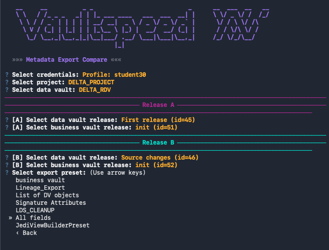

# VaultSpeed Metadata Export Compare

An interactive CLI tool that connects to your VaultSpeed subscription, generates metadata exports for two releases, and produces a colour-coded diff with a JSON and Markdown report.



---

## Requirements

- Python **3.9** or higher
- Access to a VaultSpeed environment (username + password)
- An internet connection to reach your VaultSpeed API
- A **metadata export preset that includes all attributes** (see below)

### VaultSpeed metadata export preset

This tool compares exports column by column. For the comparison to be meaningful, the preset you select must include **all available attributes** — not a filtered or reduced set.

To verify or create such a preset in VaultSpeed:

1. Go to **Metadata Export** in your VaultSpeed environment.
2. Open or create a preset and make sure **all attribute columns are enabled**.
3. Use that preset when the tool prompts you to select one.

The tool uses the following columns as the **comparison key** (any of these that are present in the export will be used):

| Key column |
|---|
| `source_name` |
| `src_physical_schema` |
| `stg_physical_schema` |
| `dv_physical_schema` |
| `cdc_physical_schema` |
| `ini_physical_schema` |
| `src_table_name` |
| `stg_table_name` |
| `dv_table_name` |
| `dv_table_type` |
| `src_column_name` |
| `stg_column_name` |
| `dv_column_name` |
| `bv_physical_schema` |
| `bv_table_type` |
| `bv_table_name` |
| `bv_column_name` |

All remaining columns in the export are compared as **values** — any difference between the two releases will be flagged.

---

## Installation

### macOS

1. **Clone the repository**
   ```bash
   git clone https://github.com/vaultspeed-labs/metadata-export-compare.git
   cd metadata-export-compare
   ```

2. **Create and activate a virtual environment** *(recommended)*
   ```bash
   python3 -m venv .venv
   source .venv/bin/activate
   ```

3. **Install dependencies**
   ```bash
   pip install -r requirements.txt
   ```

---

### Windows

1. **Clone the repository**
   ```cmd
   git clone https://github.com/vaultspeed-labs/metadata-export-compare.git
   cd metadata-export-compare
   ```

2. **Create and activate a virtual environment** *(recommended)*
   ```cmd
   python -m venv .venv
   .venv\Scripts\activate
   ```

3. **Install dependencies**
   ```cmd
   pip install -r requirements.txt
   ```

> **Windows Terminal tip:** For the best colour rendering, use [Windows Terminal](https://aka.ms/terminal) instead of the classic Command Prompt. PowerShell works well too.

---

## Running the tool

### macOS
```bash
python main.py
```

### Windows
```cmd
python main.py
```

---

## Interactive flow

Once started, the tool walks you through the following steps:

```
1. Credentials      — select a saved profile or enter new credentials
2. Project          — pick a VaultSpeed project (sorted alphabetically)
3. Data vault       — pick a data vault within that project
4. Release A        — select a DV release, then a BV release (baseline)
5. Release B        — select a DV release, then a BV release (compare to)
6. Export preset    — auto-selected if only one exists, otherwise prompted
```

At any prompt, select **‹ Back** to return to the previous step. Press **Ctrl+C** to exit at any time.

---

## Credential profiles

On first run you will be prompted for:

| Field | Description |
|---|---|
| **Base URL** | Your VaultSpeed API base URL, e.g. `https://app.vaultspeed.com/api` |
| **Username** | Your VaultSpeed login e-mail |
| **Password** | Your VaultSpeed password |

You can save these as a named profile for future runs. Profiles are stored **encrypted** on disk:

- **macOS / Linux:** `~/.vaultspeed-compare/credentials.enc`
- **Windows:** `C:\Users\<you>\.vaultspeed-compare\credentials.enc`

---

## Output

After the comparison completes, two report files are written to your current working directory:

| File | Contents |
|---|---|
| `compare_<A>_vs_<B>_<timestamp>.json` | Structured diff — added, removed, and changed rows with field-level from/to values |
| `compare_<A>_vs_<B>_<timestamp>.md` | Human-readable Markdown report with summary table and per-section diff tables |

The terminal output shows:

- A **summary panel** with row counts (unchanged / added / removed / changed)
- **Added rows** in green
- **Removed rows** in red
- **Changed rows** in orange — with side-by-side old and new values per column

---

## Ignored columns

The following columns are excluded from the comparison because they contain release-specific identifiers that differ by definition and carry no meaningful diff signal:

`tab_col_dv_vs_id`, `datavault`, `source`, `src_name`, `dv_vs_id`, `tab_dv_vs_id`, `bv_vs_id`

To change this list, edit the `IGNORED_COLUMNS` set at the top of `compare.py`.

---

## Project structure

```
metadata-export-compare/
├── main.py               # CLI entry point and interactive flow
├── vaultspeed_client.py  # VaultSpeed API client
├── compare.py            # CSV diff logic
├── display.py            # Rich terminal visualisation
├── auth.py               # Encrypted credential profile management
└── requirements.txt      # Python dependencies
```

---

## Troubleshooting

**`ModuleNotFoundError`**
Run `pip install -r requirements.txt` inside your activated virtual environment.

**`Login failed`**
Double-check your base URL, username, and password. The base URL should end with `/api`, e.g. `https://app.vaultspeed.com/api`.

**Colours not rendering on Windows**
Use Windows Terminal or PowerShell. If colours still look wrong, run:
```cmd
pip install colorama
```

**`Metadata export not ready after 120 seconds`**
The export is taking longer than expected on the server side. Re-run the tool — the export may succeed on a subsequent attempt, or contact your VaultSpeed administrator.
